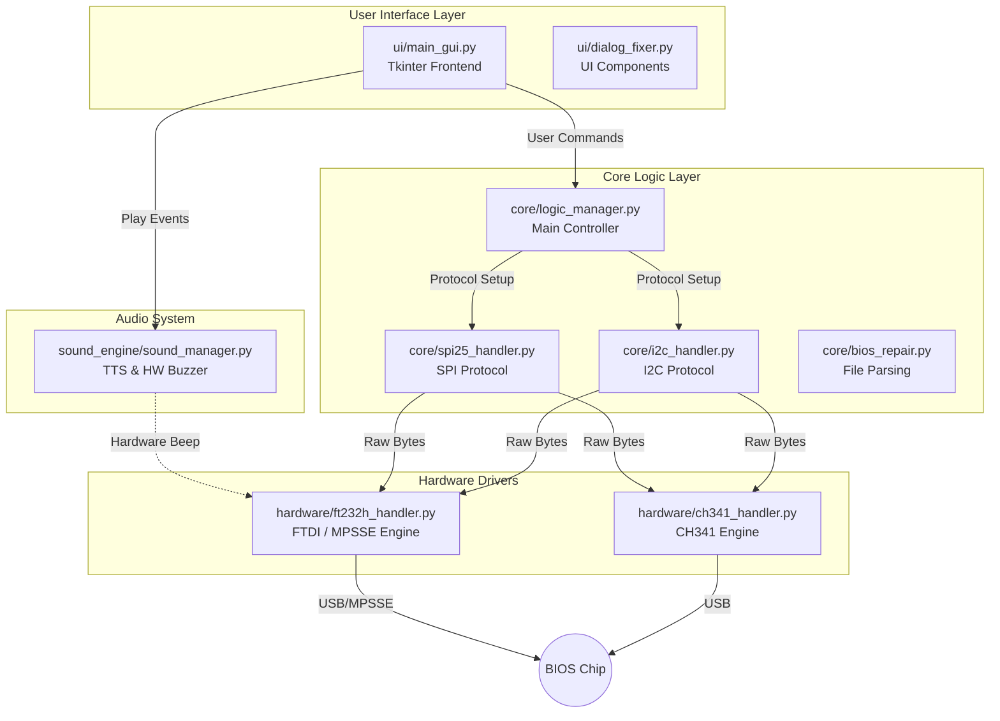

# R1 BIOS Programmer - Architecture & Mind Graph

> [!NOTE]
> This document serves as a comprehensive architectural map of the **R1 BIOS Programmer** project. It is designed to help future engineers and developers understand the data flow, protocols, file structures, and recent modifications at a glance.

## 1. High-Level Architecture (Mind Graph)

The system is designed with a layered architecture, separating the graphical user interface (GUI) from the business logic (Core) and the physical hardware drivers.

---

## 2. Directory & File Structure

Here is the exact location of each file and its specific responsibility:

### `/ui/` (User Interface)
*   **`main_gui.py`**: The primary entry point of the software. Contains the massive Tkinter-based GUI, event handlers, settings, memory viewer, and log output.
*   **`dialog_fixer.py`**: Helper classes for custom UI dialogs and pop-ups.
*   **`qt_main.py`**: Experimental or alternate PyQt based frontend.

### `/core/` (Business Logic & Protocols)
*   **`logic_manager.py`**: The "brain" of the app. It connects the UI buttons (Read, Write, Erase, Verify) to the correct protocol handler based on the selected chip type.
*   **`spi25_handler.py`**: Implements the **SPI (Serial Peripheral Interface)** protocol (Standard JEDEC 25xx series). Uses Hex opcodes like `0x9F` (Read ID), `0x06` (Write Enable), `0x03` (Read).
*   **`i2c_handler.py`**: Implements the **I2C** protocol (24xx series EEPROMs). Calculates correct slave device address and word address bytes based on `addrtype` (24C01 through 24C1024).
*   **`bios_repair.py`**: Utility to parse and patch BIOS dumps or split files.
*   **`system_log.py`**: Advanced logging system.

### `/hardware/` (Driver Layer)
*   **`ft232h_handler.py`**: The primary hardware driver for the **FTDI FT232H** chip. Uses the **MPSSE** (Multi-Protocol Synchronous Serial Engine) via `ftd2xx.dll`. Responsible for ultra-high-speed USB-to-SPI/I2C conversion and bit-banging GPIOs (Relays, LEDs, Buzzers).
*   **`ch341_handler.py`**: Fallback driver for the standard CH341A programmer via `CH341DLL.dll`.

### `/sound_engine/` (Audio)
*   **`sound_manager.py`**: Handles Text-to-Speech (TTS) announcements on the PC and triggers hardware-level buzzer sounds via the hardware drivers.

---

## 3. Protocols Used

> [!TIP]
> The software communicates with target chips using the following standards:

1.  **MPSSE (via FT232H)**: 
    *   Command `0x80`: Sets ADBUS (Lower 8 pins, D0-D7) direction and value. Used for SPI pins and Buzzer (`AD7`).
    *   Command `0x82`: Sets ACBUS (Upper 8 pins, AC0-AC7) direction and value. Used for Voltage relays and Status LEDs.
    *   Commands `0x11` / `0x20` / `0x24`: Clock data in/out for SPI reads and writes.
2.  **SPI (Serial Peripheral Interface)**: Uses 4 wires (CS, CLK, MOSI, MISO) operating at up to 30MHz (Divisor `0`).
3.  **I2C (Inter-Integrated Circuit)**: Uses 2 wires (SDA, SCL). Bit-banged via MPSSE GPIO commands to simulate Start/Stop/ACK conditions.

---

## 4. Recent Critical Changes & Changelog

Future engineers, pay close attention to this section regarding the **Hardware Buzzer implementation on the FT232H module**.

> [!WARNING]
> **FT232H EEPROM Lock Issue:** By default, many FT232H modules have their upper ACBUS pins (AC4=TXLED, AC5=RXLED) locked by the internal EEPROM. MPSSE software commands *cannot* override these pins to act as normal GPIOs.

### Change History (Buzzer & Threading)
*   **Attempt 1 (AC4 & AC5)**: Initially tried routing the buzzer to AC4 and AC5. Failed because of the EEPROM hardware lock on these pins.
*   **Attempt 2 (AC6)**: Moved the buzzer to AC6. Failed because some generic modules do not physically expose AC6 to the pin headers.
*   **Attempt 3 (AD7 - Final)**: Moved the buzzer to **ADBUS bit 7 (AD7 / GPIOL3)**. This pin is fully programmable, not EEPROM-locked, and physically available on all boards.
*   **Threading Fix**: The FT232H driver was suffering from race conditions. The `sound_manager` thread and the `spi25_handler` thread were both calling `write_raw()` at the same time, corrupting the MPSSE command stream. 
    *   *Solution*: Implemented a `threading.RLock()` in `ft232h_handler.py` wrapping all `FT_Write` and `FT_Read` calls to ensure thread safety. Added a 3-second timeout for the buzzer to prevent deadlocks during long SPI reads.
*   **Temporary UI Modification**: The Hardware Buzzer toggle in `main_gui.py` (`chk_buzzer`) has been temporarily disabled/hidden from the Settings dialog until the next major release where the hardware side is fully stabilized.
*   **MicroWire Removal & I2C Overhaul**:
    *   **MicroWire Excised**: Removed legacy `microwire_handler.py`, removed `MW` from protocol menus, UI wiring diagrams, and `chiplist.xml`.
    *   **I2C 24-Series Architecture (Based on Phase6)**: Overhauled `i2c_handler.py` with multi-tier `addrtype` decoding (24C01 through 24C1024), handling 1-byte, 2-byte word addresses, device address high-bit banking, and 10ms EEPROM cycle write delays.
    *   **Separation of Chip Lists**: Sidebar database explorer and chip selection dialog now strictly filter between SPI Flash (25-series) and I2C EEPROMs (24-series). Smart Identify informs users that 24-series I2C chips do not support JEDEC Auto-ID and opens the manual I2C chip selection modal.

